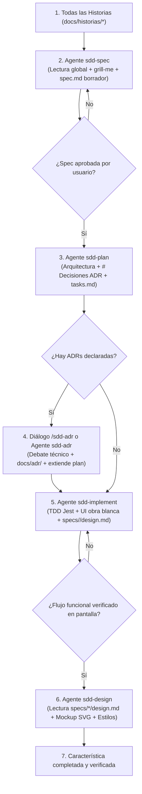

# Spec-Driven Development (SDD) – Flujo Evolucionado

Metodología de desarrollo formal basada en especificaciones rigurosas, desacoplamiento estricto entre lógica y diseño visual ("obra blanca"), decisiones técnicas documentadas conversacionalmente (ADRs) y arquitectura modular por agentes especializados.

---

## 1. El Pipeline SDD

---

## 2. Los 5 Principios Fundamentales del Flujo

1. **Lectura Global de Historias (Cero Visión de Túnel):** Antes de redactar la spec, el agente `sdd-spec` lee **todas las historias** existentes para conocer el alcance general y blindar la sección `## Fuera de alcance` citando qué historias futuras cubrirán las funciones posteriores.
2. **Plan y Tareas con Decisiones ADR:** El agente `sdd-plan` unifica la arquitectura y el desglose de tareas ($\le 10$), declarando cada necesidad de librerías una por una en `# Decisiones ADR` sin nombres comerciales. Las tareas vinculan su dependencia (`Requiere: ADR-REQ-XX de plan.md`).
3. **Resolución Conversacional de ADRs:** El subagente `sdd-adr` (o comando `/sdd-adr`) abre un diálogo técnico consultivo para debatir opciones reales, redacta `docs/adr/ADR-00X-*.md` (dejando `## Uso de IA` para el usuario) y extiende el plan con la librería y comando acordados.
4. **Implementación y Obra Blanca:** El agente `sdd-implement` aplica TDD estricto con Jest, levanta la interfaz funcional en **obra blanca** (operable en pantalla real sin retrasos estéticos) y genera `specs/<id-spec>/design.md` estructurado de lo general a lo atómico (Pantallas $\rightarrow$ Organismos $\rightarrow$ Moléculas $\rightarrow$ Átomos).
5. **Diseño Visual Desacoplado:** El agente `sdd-design` mapea todas las obras blancas (`specs/*/design.md`) para definir una navegación global armónica (tabs, stack, modales, desplegables), presenta la maqueta visual mediante un **Mockup SVG** a escala y, tras la aprobación del usuario, aplica los estilos limpios extendiendo `design.md` con la sección `## Estilo y Diseño Aplicado`.

---

## 3. Catálogo Oficial del Sistema SDD

### Subagentes Especializados (`.agents/agents/`)

| Subagente | Rol y Responsabilidad | Herramientas / Skills |
| :--- | :--- | :--- |
| **`sdd-spec`** | Analiza la HU en contexto global, realiza el interrogatorio `grill-me` y genera `decisiones.md` y `spec.md` en borrador. | `grill-me`, `sdd-spec` |
| **`sdd-plan`** | Diseña la arquitectura técnica, declara `# Decisiones ADR` y desglosa `tasks.md` ($\le 10$ tareas) con trazabilidad. | `sdd-plan`, `sdd-tasks`, `sdd-adr` |
| **`sdd-adr`** | Analiza colaborativamente las necesidades de librerías de `# Decisiones ADR`, debate opciones, redacta `docs/adr/` y extiende el plan. | `sdd-adr` |
| **`sdd-implement`** | Ejecuta tareas con TDD (`npx jest`), levanta la UI en obra blanca y genera `specs/<id-spec>/design.md`. | `sdd-implement` |
| **`sdd-design`** | Mapea todas las obras blancas (`specs/*/design.md`), genera el Mockup SVG y aplica los estilos limpios definitivos. | `sdd-plan-design`, `sdd-implement-design` |

### Skills y Guías de Trabajo (`.agents/skills/`)

| Skill | Propósito |
| :--- | :--- |
| **`sdd`** | Guía maestra y orquestador del ciclo de vida SDD completo. |
| **`grill-me`** | Protocolo de interrogatorio directo una a una para resolver dudas sin improvisar. |
| **`sdd-spec`** | Reglas de sintaxis EARS, blindaje de fronteras y plantilla oficial de `spec.md`. |
| **`sdd-plan`** | Reglas de diseño de arquitectura modular, desacoplamiento y sección `# Decisiones ADR`. |
| **`sdd-tasks`** | Criterios de atomicidad ($\le 10$ tareas, 20-30 min) y verificación verificable. |
| **`sdd-adr`** | Diálogo colaborativo para debatir alternativas de librerías y plantilla formal de ADR. |
| **`sdd-implement`** | TDD estricto, protocolo de obra blanca y plantilla de transferencia de `design.md`. |
| **`sdd-plan-design`** | Mapeo de navegación global (`specs/*/design.md`), Mockup SVG y extensión de diseño. |
| **`sdd-implement-design`** | Pautas de codificación visual limpia y sobria basada en tokens del proyecto. |
